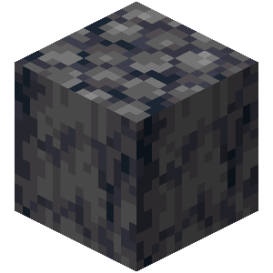
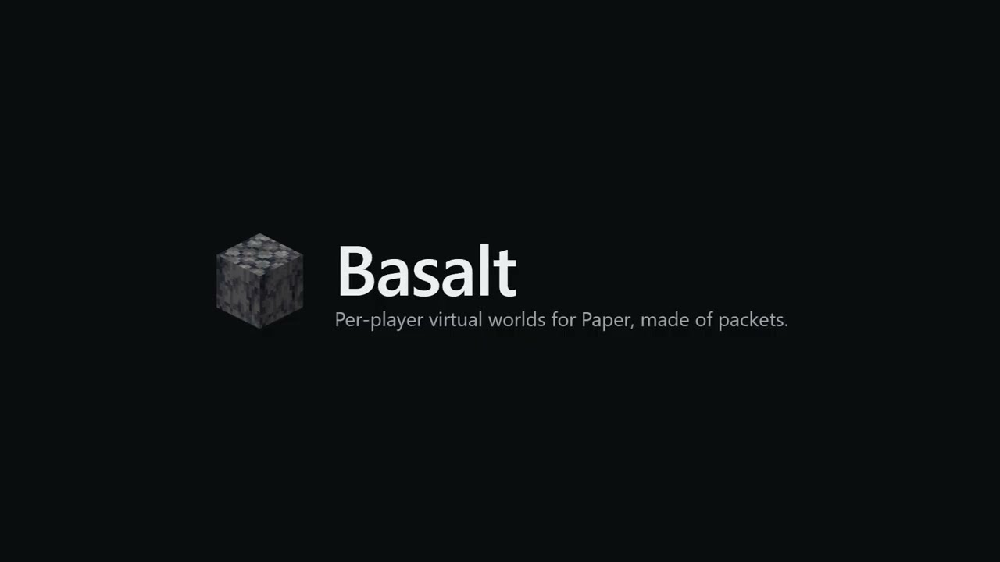

<p align="center"></p>
<h1 align="center">Basalt</h1>
<p align="center">Per-player virtual worlds for Paper, made of packets.</p>
<p align="center"><a href="https://github.com/basalt-lib/BasaltCore/actions/workflows/build.yml"></a>   <a href="LICENSE"></a></p>

## Features

- Virtual worlds on top of a real area, one per player or group, several can overlap
- Virtual blocks and entities, shared by the viewers of a world
- Events: break, place, use and damage (cancellable), entity death, viewer add and remove
- Blueprints: capture a real area, load a vanilla `.nbt` structure or a Sponge `.schem`
- Packets only: no extra world, no server fork, no client mod

## Showcase

<p align="center"><a href="https://www.youtube.com/watch?v=KCYVns9mYfQ"></a></p>
<p align="center"><a href="https://www.youtube.com/watch?v=KCYVns9mYfQ">Watch the showcase on YouTube</a></p>

## Quick look

From [RunWorlds](https://github.com/basalt-lib/BasaltDemo/blob/master/src/main/java/tlm/dev/basalt/demo/play/RunWorlds.java) in BasaltDemo. Main thread only. Teleport the player into the area's world before `addViewer`.

```java
VirtualWorld startRun(Plugin plugin, Blueprint dungeon, Location origin, Player player) {
    Location corner = origin.clone().add(dungeon.sizeX(), dungeon.sizeY(), dungeon.sizeZ());
    ChunkArea area = ChunkArea.ofBlocks(origin.getWorld(), BoundingBox.of(origin, corner));
    VirtualWorld world = BasaltProvider.get().createWorld(plugin, area);
    world.place(dungeon, origin.getBlockX(), origin.getBlockY(), origin.getBlockZ());
    VirtualEntity zombie = world.spawnEntity(EntityType.ZOMBIE, origin.clone().add(14.5, 1, 4.5));
    zombie.setCustomName(Component.text("Dungeon Zombie"));
    zombie.setMaxHealth(6);
    player.teleport(origin.clone().add(3.5, 1, 7.5));
    world.addViewer(player);
    return world;
}
```

## Install

Paper 1.21.11, Java 21+. Put `BasaltCore-<version>.jar` in `plugins/`.

Not on a Maven repository yet. Build with JDK 25 and install the API locally:

```bash
git clone https://github.com/basalt-lib/BasaltCore.git
cd BasaltCore
./gradlew build
./gradlew :api:publishToMavenLocal
```

Plugin jar: `plugin/build/libs/BasaltCore-0.1.0-SNAPSHOT.jar`.

`build.gradle.kts`:

```kotlin
repositories { mavenLocal() }
dependencies { compileOnly("tlm.dev.basalt:basalt-api:0.1.0-SNAPSHOT") }
```

`paper-plugin.yml`:

```yaml
dependencies:
  server:
    BasaltCore:
      load: BEFORE
      required: true
      join-classpath: true
```

## Configuration

`plugins/BasaltCore/config.yml`, created on first start. A missing or invalid key falls back to its default. No reload command.

<details><summary>All keys</summary>

| Key | Default | Description |
|---|---|---|
| `interaction.max-actions-per-second` | `20` | Block and entity actions per viewer per second, extra ones are dropped |
| `interaction.reach-margin` | `1.0` | Added to the block reach |
| `interaction.entity-reach-margin` | `3.0` | Added to the entity reach |
| `entity.max-per-world` | `16` | Virtual entities per world |
| `visibility.entity-scan-interval-ticks` | `5` | Ticks between two scans hiding the real entities of a virtual world |
| `visibility.max-entities-per-scan` | `256` | Real entities hidden or shown per viewer per scan |
| `world.max-chunks` | `256` | Chunks per virtual world |
| `world.max-worlds` | `64` | Open virtual worlds |
| `world.max-chunk-sends-per-tick` | `16` | Virtual chunks sent per tick, all viewers together |
| `world.encoder-threads` | `2` | Threads encoding chunk packets |
| `blueprint.max-blocks` | `1000000` | Blueprint volume, air included |
| `blueprint.max-file-bytes` | `33554432` | Blueprint file size once decompressed |

</details>

## Commands and permissions

`/basalt debug` is a debug tool for admins and the console, not part of the API. Permission `basalt.admin` (default `op`).

- `chunk`, `world`: create, list, inspect and close worlds, add and remove viewers
- `entity`: spawn, move, set health, remove
- `blueprint`: capture, read, place, drop
- `events`: record, cancel or change `Virtual*Event`

## Example

[BasaltDemo](https://github.com/basalt-lib/BasaltDemo): an instanced dungeon on the public API only.

## Limits

- No persistence: worlds are gone on shutdown
- Virtual entities: no AI, no movement, no equipment
- Blueprints: no rotation or mirror, block states only (no entities, no block entity data)
- Virtual chunks: full sky light, no block light, plains biome
- The real area must be air, `createWorld` checks it
- Bukkit events don't fire for virtual actions, use `Virtual*Event`
- Paper 1.21.11 only, no Folia

## Status

Experimental API (`@ApiStatus.Experimental`), may change before 1.0. Not published to a Maven repository yet.

## License

Apache-2.0, see [LICENSE](LICENSE).

Not an official Minecraft product. Not approved by or associated with Mojang or Microsoft. The icon is the Minecraft basalt block, property of Mojang.
